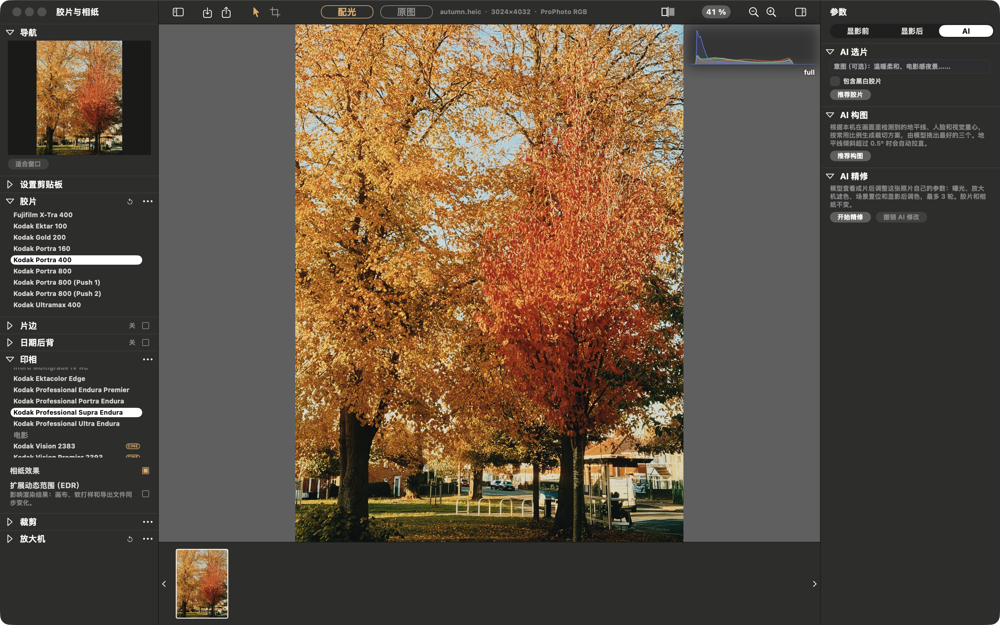

<!-- README_SYNC: source=f2aa1b9; updated=2026-11-02 -->
<p align="center">
  English · <a href="./README.zh-CN.md">简体中文</a>
</p>

# SpektraLab AI (unofficial fork)

A spectral film and print simulator for macOS, plus an AI workflow that
**picks a film, suggests crops, smooths skin and fine-tunes the print** for you.
Open a RAW and get a physically modelled print in about a second.

> This is a personal fork of [JamesQiu2005/SpektraLab](https://github.com/JamesQiu2005/SpektraLab),
> not the official app. The film simulation comes from upstream; what this fork
> adds is the [AI tab](#added-in-this-fork-ai-film-choice-crops-skin-and-refine).

If it's useful to you, a [⭐ Star](https://github.com/Shaojie66/spektralab-ai/stargazers)
bookmarks it and helps other film-simulation people find it.

[](https://github.com/Shaojie66/spektralab-ai/stargazers)
[](https://github.com/JamesQiu2005/SpektraLab)
[](#build-from-source)
[](LICENSE.txt)
[](https://github.com/Shaojie66/spektralab-ai/commits/main)


## Why SpektraLab

Most "film filters" are a LUT plus a layer of noise. SpektraLab does what the darkroom does:

- **Spectral, not a LUT.** Light is traced through 81 wavelengths, the film's
  dye layers and the paper's.
- **Physical units.** Tell it the negative is 120 or 35 mm and the grain,
  halation and coupler diffusion scale with the frame in micrometres.
- **Fast.** A C++ Metal engine compiled into the app: a 45 MP reprint in
  ~0.01 s at preview size, a full-resolution render in under a second.
- **One colour pipeline.** ProPhoto RGB throughout; each export is gamut-mapped
  once into the space you ask for, and proofed before it is written.
- **The film itself.** Film Edge prints the frame on its own strip, measured on
  real strips, in 135, half frame, XPan, 645 to 6×9, 6×12 and 6×17. Date Back
  exposes a date onto the negative; half-frame pairs put two photos on one frame of 135.
- **Scriptable.** `spektralab` (CLI) and an MCP server drive the same session
  the window does. Off until enabled in Settings.

| RAW decode ⟷ film and paper (⌥\\) | grain at 1:1 |
|---|---|
|  |  |

Selecting and syncing photos, Film Edge, Date Back and half-frame pairs are
covered step by step in the [usage guide](docs/USAGE.md).

## Added in this fork: AI film choice, crops, skin and refine

There are hundreds of film and paper pairings, and trying them one by one is
slow. This fork adds an **AI** tab to the Parameters rail so a vision model
takes the first pass. It **only moves existing controls; it never edits the
print's pixels.**



| Feature | What it does | API key? |
|---|---|---|
| **Choose a film** | Prints a small proof on each colour film with its paper, measures clipping, brightness, contrast and cast, and asks the model for 3–5 scored choices with reasons. 19 films at 768 px take about 3 s on an M-series Mac | Yes |
| **Compose** | Measures horizon, saliency and faces locally with Apple's Vision framework, builds 8–12 crop candidates by rule, and lets the model pick the best three. Never cuts a face; levels a horizon off by more than 0.5° | Yes (measuring is local) |
| **Skin smoothing** | A 0–100 slider under **Portrait** in the Pre-Dev tab. Works on the face only, keeps eyes, brows and lips sharp, and runs before the film, so grain and halation still land on the skin | No, fully local |
| **Refine** | Shows the model a 1024 px print and allows up to three rounds of changes to metering, exposure, filtration, grain, halation and grading. It cannot change film, paper, crop or Film Edge; out-of-range changes are refused | Yes |

**Undo AI changes** restores everything in one step. Half-frame pairs are not
yet supported.

**Turn it on:** Settings ▸ AI, pick a provider and enter its key. Anthropic
Claude (default `claude-opus-5-5`), any OpenAI-compatible `/chat/completions`
service, and local Ollama (`http://localhost:11434/v1`, no key) all work.

**What leaves your Mac:** photos are sent only when you press **Recommend**,
**Recommend crops** or **Refine**, together with exposure data and edit values.
Usage is billed to your own API account. Keys live in the macOS Keychain, not
in settings, sidecars or logs.

The rules, thresholds and test results for each feature are in the
[AI feature guide](docs/AI.md).

## Build from source

The AI tab only exists in this fork's source. The DMG on
[spektralab.app](https://spektralab.app) and upstream
[Releases](https://github.com/JamesQiu2005/SpektraLab/releases) is the official
app **without** it, and this fork has no published builds, so build it yourself.

Apple silicon, macOS 15 or later, Xcode 26.6.

```bash
engine/build.sh bundle                 # engine, kernels, baked resources
cd modern_UI/Spektrafilm
xcodebuild -project Spektrafilm.xcodeproj -scheme Spektrafilm \
           -derivedDataPath build/DerivedData build
```

Re-run `engine/build.sh bundle` whenever `engine/resources/` changes. If Xcode
suddenly cannot find `metal`, clean the build folder (⇧⌘K): the Metal
toolchain's mount path changed under a cached build.

### Test

```bash
xcodebuild -project Spektrafilm.xcodeproj -scheme SpektrafilmTests \
           -derivedDataPath build/DerivedData test       # ~550 tests, ~6 min
```

Camera fixtures come from the upstream `spektrafilm` repository through a
`tests` symlink (`ln -s ../spektrafilm/tests tests`). Without it 25 cases skip
and the run still reports 0 failures in ~20 s — trust the duration.

## Layout

| | |
|---|---|
| `modern_UI/Spektrafilm/` | the app: SwiftUI, AppKit, Metal |
| `modern_UI/Spektrafilm/Spektrafilm/AI/` | this fork's AI features |
| `engine/` | the C++20 render engine, its MSL kernels and C ABI |
| `engine/resources/` | baked constants, 28 film and paper profiles, print LUTs |
| `ARCHITECTURE.md` | how it fits together — start here |
| `AGENTS.md` | conventions and the traps that cost real time |

### Windows development

The repository also has a C++/Vulkan backend, native LibRaw decoding, RGB16
TIFF export and Windows desktop viewers. See the
[Windows build guide](engine/WINDOWS.md),
[feature coverage](engine/WINDOWS_FEATURE_COVERAGE.md), the
[Qt Quick frontend](windows_UI/README.md) and the
[minimal Win32 viewer](engine/WINDOWS_DESKTOP.md). The macOS app described above
has features not yet ported to Windows.

## Contributing

Changes to the film simulation itself belong in the
[upstream repository](https://github.com/JamesQiu2005/SpektraLab), under its rules:

- **Windows and Linux work goes to the `Windows_Linux` branch, never to `main`.**
- **Split your work into reviewable commits.** One commit per change, each with
  a message that says what it does and why.
- **Respect the open-source community.** Keep the licences and credits intact,
  credit the work you build on, and be civil in issues and reviews.

Pull requests that improve the AI features are welcome here.

## Credits and licence

The film process model, its 28 measured color profiles and the print LUTs are
[spektrafilm](https://github.com/andreavolpato/spektrafilm) by Andrea Volpato;
4 new measured B&W profiles are by Hanze Qiu;
SpektraLab is a native C++/Metal port of that engine and the application built
around it.

| | |
|---|---|
| app and engine | GPL-3.0-or-later |
| film and paper profiles, print LUTs | CC BY-SA 4.0 |
| metal-cpp | Apache-2.0 |

All texts ship inside the app, under **SpektraLab → About SpektraLab**.

## Trademark

SpektraLab™ and the SpektraLab icon are managed by Guangzhou Songzi Intelligent
Technology Services Co., Ltd.; trademark registration is in progress. This
repository is a personal fork, not an official build, and is not endorsed by
the SpektraLab project.

From upstream: forks are welcome. You can study, modify, port and redistribute
the code under its licences, which cover the code and data but not the name or
the icon. Keeping both in a personal fork is fine. If you publish a build for
other people, even a free one, please give it its own name and icon.

---

If it saved you time, [⭐ Star it](https://github.com/Shaojie66/spektralab-ai/stargazers);
to follow new upstream versions, [watch upstream Releases](https://github.com/JamesQiu2005/SpektraLab/releases).
