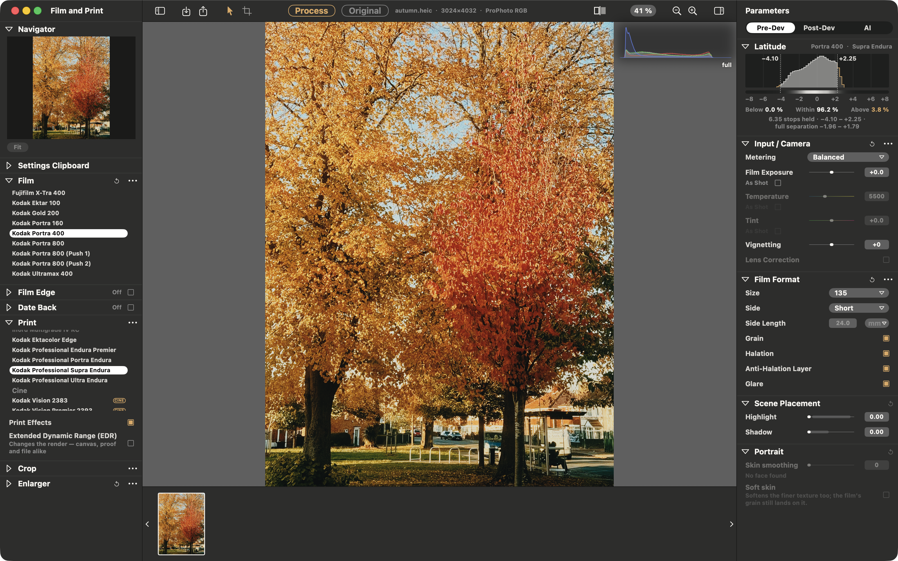

# SpektraLab™

**English** · [简体中文](README.zh-CN.md) · [spektralab.app](https://spektralab.app)

A film and print simulator for macOS. Open a RAW, pick a film and a paper,
and get a physically modelled print — grain, halation, couplers, the enlarger's
filter pack — in about a second.



- **Spectral, not a LUT.** Light is traced through 81 wavelengths, the film's
  dye layers and the paper's, the way a darkroom does it.
- **Physical units.** Tell it the negative is 120 or 35 mm and the grain,
  halation and coupler diffusion scale with the frame in micrometres.
- **Fast.** A C++ Metal engine compiled into the app: a 45 MP reprint in
  ~0.01 s at preview size, a full-resolution render in under a second.
- **One colour pipeline.** ProPhoto RGB throughout; each export is gamut-mapped
  once into the space you ask for, and proofed before it is written.
- **The film itself.** Film Edge prints the frame on its own strip — rebate,
  perforations, each stock's edge print and frame numbers, measured on real
  strips — in 135, half frame, XPan, 645 to 6×9, 6×12 and 6×17. Date Back
  exposes a date onto the negative.
- **Half-frame pairs.** Two frames on one piece of film, side by side or one
  above the other, each with its own exposure, white balance, print and grade.
- **Scriptable.** `spektralab` (CLI) and an MCP server drive the same session
  the window does. Off until enabled in Settings.

| RAW decode ⟷ film and paper (⌥\\) | grain at 1:1 |
|---|---|
|  |  |

## Install

Download the DMG from [spektralab.app](https://spektralab.app) or
[Releases](https://github.com/JamesQiu2005/SpektraLab/releases), open it and
drag SpektraLab to Applications. It is signed with a Developer ID and
notarised by Apple, so it opens like any other app.

Apple silicon, macOS 15 or later.

Releases before 1.3.3 are ad-hoc signed. For one of those, clear the
quarantine once:

```bash
xattr -d -r com.apple.quarantine /Applications/SpektraLab.app
```

## Select and sync photos

Click a photo to make it the current photo, then Command-click other photos to
add or remove them without moving the current photo. Command+A (Edit → Select
All Photos) selects the library and keeps the current photo as the sync source.
In a newly opened folder it opens the first photo. Command+A inside a text field
still selects text.

Under Settings Clipboard, tick the groups to transfer and choose **Sync to N**
(or Edit → Sync Settings). This reads the current photo's latest edits, preserves
the clipboard and source photo, and saves the other selected photos immediately.
They develop with those settings when opened. Crop, Post-Dev adjustments, lens
correction, Film Edge and Date Back stay with each photo, following the existing
clipboard rules. As Shot white balance and fitted Scene Placement are resolved
for each target. Sync has no batch undo; the status reports writes and failures.
Selection and sync are disabled during batch export.

## Film Edge, Date Back and half-frame pairs

**Film Edge** (left rail) turns the canvas into the film: pick a format and the
frame is cut to its gate and shown on the strip, with the stock's own edge
print and a frame number you can set; a strip scan ends at the film's edges.
The crop becomes the framing in the gate, so it is part of the
negative. **Date Back** exposes the shooting date (or a date you type) into the
frame; it needs no film edge. With one, it can print the shooting data beside
the frame at the same time, and on 120 (645 to 6×9) the date and the data go
in the film margin, where a medium-format back printed them.

**A half-frame pair** is two frames on one frame's worth of 135. With Film Edge
on *Half*, **Enter Half-Frame Pair** appears under the format (or pick two
photos and press ⌘J). The canvas shows two holes; an empty one has a **+**.
Click a hole to pick its frame: Input / Camera, Scene Placement, the Enlarger
and Post-Dev then act on that frame alone, and *+ Film* moves the film around
it too. Right-click a hole to replace, turn or crop its frame. In the crop
mode, drag moves the picture under its hole and scroll or pinch scales it about
the pointer. A pair is one item in the filmstrip and exports as one picture.

Drag a thumbnail along the filmstrip to reorder a folder; the order is kept for
that folder. A file dropped from Finder still opens and edits.

## AI film choice, composition, skin smoothing and refinement (this fork)

The Parameters rail has an **AI** tab. It is off by default: turn it on in
**Settings ▸ AI**, choose a provider and enter its API key. For an
OpenAI-compatible `/chat/completions` service, enter its base URL and a model
that accepts images. Local Ollama can use `http://localhost:11434/v1` without
a key. Anthropic Claude defaults to `claude-opus-5-5`; `claude-sonnet-5-5`,
`claude-fable-5-1` and `claude-haiku-5-5` are also available.

**Choose a film** first sets exposure if the photo is still on the default
(balanced automatic metering, zero compensation). It proofs the current film
with balanced, center, protect highlights and protect shadows metering, then
asks the model to choose from a contact sheet for the scene: protect highlights suits night, fireworks,
stage and backlit scenes; protect shadows suits snow, beaches and bright skies.
Average metering can turn a night scene grey, making film comparison meaningless.
The choice is saved to the photo and included in **Undo AI changes**; if the model's
answer cannot be read, the existing setting is kept. Non-default exposure settings
are also kept, and the interface shows whether AI chose or the setting was retained.

It then prints small proofs on each colour film with its declared paper (slides
are scanned), skips push-process variants and puts the current combination first;
black and white can be included. Each proof uses the photo's current exposure and
the same otherwise neutral settings: a neutral filter pack, without Scene
Placement, grain, glare or grading. A vision model receives a numbered contact
sheet and measurements of clipping, brightness, contrast, colourfulness, cast
and latitude coverage, then returns 3–5 choices with scores and reasons.
**Apply** selects the film and paper and presses Process. Proofs run in a
separate engine instance, leaving the canvas, edit and undo history alone;
19 films at 768 px took about 3 seconds on an M-series Mac.

**Compose** suggests crops. **Recommend crops** first measures one whole-frame proof
on the Mac with the Vision framework: horizon tilt, visual centre of gravity (saliency)
and faces. This runs locally, is free and needs no network. It then builds 8–12 crop
candidates by rule. A salient region that is a subject (up to 35% of the frame) goes on a
third or centred. A larger one, as in a landscape or cityscape, is treated as the scene: the
candidates are the largest crop at each ratio, that crop slid to keep the top or the bottom
(more sky or more foreground) or the left or the right, and a slightly tighter centred crop.
Ratios follow the picture's orientation (landscape: original, 3:2, 5:4, 1:1, 16:9; portrait:
original, 2:3, 4:5, 1:1, 9:16), and candidates are levelled automatically when the horizon is
off by more than 0.5°. Tile 1 is always the current framing, for comparison. Hard rules:
never cut a face, keep at least 90% of a subject's salient region (60% for a scene), cover at
least 40% of the original, and merge near-identical candidates. The candidates are rendered
as a numbered sheet and the model only picks the best three and says why; it never names
coordinates, because vision models compare pictures well but place a rectangle badly.
Each tile uses the same crop transform as Apply, so what you see is what you get.
**Apply** crops and levels the photo by that plan, keeping your earlier 90° turns and
flips; **Undo AI changes** restores it in one step. Not available with Film Edge on or in
half-frame pairs. Local Ollama (for example `gemma4:26b`) and Claude both work.

**Skin smoothing** is in the Pre-Dev tab, under **Portrait**: a 0–100 slider,
0 (off) by default, applied when you release it. It needs no API key. Where the Mac's Vision framework finds no
face the slider is disabled and says why. It is also disabled when **Don't Apply Film Simulation** is on, because the
canvas then shows the untouched photo, with "Smoothing is done before the film, so it does not apply with the film
simulation off." shown under it. Undo works as usual. Face landmarks are
detected locally, free and with no network. To find the small faces in a group photo,
faces are looked for on the whole picture and on overlapping tiles of it, and each
face's landmarks are then read on its own enlarged crop: in tests, 19 faces in a group
of about 25 people (7 when looking at the whole picture only) and 8 in a group of 10
(6). Faces mostly hidden behind someone, or turned far away, are not found. A face that is
found but whose features (eyes, brows, lips, nose) cannot be read, because it is too small,
turned too far or covered, is left unsmoothed, and the line under the Portrait slider says how many, e.g.
"19 faces · 1 more with features that cannot be read, left as they are". When even the largest face is under
5% of the photo's long edge (a group of about 25 people at 1440 px, largest face 3.4%), the line
adds "all small, so it barely shows". AI Refine is given the same two facts. The mask
covers the face outline with
the forehead added, cuts out the eyes, brows, lips and nose so the features stay
sharp, and is pulled in and feathered at the edge, leaving the hairline and
background alone. Neck and body skin are not touched. It removes mid-scale blotches
and unevenness while keeping the coarser light and shade of the face, and by default
the finer pore texture too. The scale is worked out from each face's own size, so a
small face at the back of a group shot is not over-smoothed. Strong lines (glasses frames, strands of hair) and the pixels beside
them are protected from softening; fine texture such as pores is not affected by that
protection. Anything on the skin much darker or lighter than the skin around it (under
about a third of its brightness, or nearly twice as bright) is treated as an object, not a
blotch, and is left as it is: the nose pads of glasses stay solid, a lens's glare stays, and a
very dark mole is kept. Ordinary blotches, acne marks and redness, which differ from the
surrounding skin by only 10–20 %, are smoothed. The higher the strength, the larger the scale of blotch it removes: at 100,
about 93 % of a medium blotch is removed, while the face's own
light and shade is still kept. Suggested use: 30–60 for small faces in a group
shot, up to 100 for a close-up. **Soft skin**, a switch under the slider in the
Portrait section, can be turned on only when the strength is above 0. It also softens the
finer skin texture (pores) for cleaner skin; the film grain still lies on top. Because
grain is what puts texture back over the skin, how much of Soft skin applies follows how
coarse the grain lands: 35 mm at the film's own grain gets all of it, finer grain (medium
format, a lower Grain slider) gets less, and with grain off it is held to 40 %, in steps
of 10 %. Grain coarseness here is Grain on/off × the Grain slider × the film's own grain
amount (only the four black-and-white films differ; colour films share one grain model) ÷
the film format size relative to 35 mm. The Portrait panel says so under the toggle when
it is held back (for example "Held to 70%"). With Soft skin on, a change to grain, film or
format that moves the cap re-develops the frame (a second or two); small slider nudges
usually do not. Like the
strength, it is stored with the photo's settings, can be undone, and is not copied
with copy/paste settings. The smoothing happens
before the film: the raw decode is retouched, then handed to the engine, so grain,
halation and the paper curve still fall on the skin and the face does not become a
smooth plastic patch in a grained picture. This is the one retouching exception in
this fork; nothing else is edited after the print. Changing the strength re-prints
the photo, about 1–2 seconds for a large image. **Refine** may also set it, only when
a face is present: usually 0.2–0.4 for a natural portrait, and none when people are
small or only background; it turns Soft skin on only when you explicitly ask for
clean, soft or beauty-style skin. In a test, local `gemma4:26b` set 0.3 for the intent
"natural portrait skin". Copy and paste settings does not copy it, since every
photo has different faces. Half-frame pairs are not yet supported.

**Refine** gives the model a 1024 px view of the print and up to three rounds
to adjust metering, Film Exposure, paper brightness, enlarger Y/M filters, pre-flash,
grain, halation, Scene Placement and Post-Dev grading. It cannot change film,
paper, crop, Film Edge, Date Back or decode; out-of-scope or out-of-range
changes are refused and reported back to the model. **Undo AI changes** restores
the edit from before AI in one step; ⌘Z can undo that restoration. This is not
generative retouching: it changes existing controls, not the film
model or the print's pixels, and the result is saved in the ordinary sidecar. Half-frame pairs are
not yet supported.

Photos are sent only when **Recommend**, **Recommend crops** or **Refine** is pressed, along with
exposure data and edit values; the connection test sends a text-only request.
Usage is billed to your own API account. Keys are stored in the macOS Keychain,
not in settings, sidecars or logs. The MCP tool `compare_stocks` also lets
external Claude Code or Claude Desktop compare films without an in-app API key;
its CLI equivalent is `spektralab compare photo.NEF --mono --preview sheet.jpg`.

## Build

Xcode 26.6.

```bash
engine/build.sh bundle                 # engine, kernels, baked resources
cd modern_UI/Spektrafilm
xcodebuild -project Spektrafilm.xcodeproj -scheme Spektrafilm \
           -derivedDataPath build/DerivedData build
```

Re-run `engine/build.sh bundle` whenever `engine/resources/` changes. If Xcode
suddenly cannot find `metal`, clean the build folder (⇧⌘K): the Metal
toolchain's mount path changed under a cached build.

## Test

```bash
xcodebuild -project Spektrafilm.xcodeproj -scheme SpektrafilmTests \
           -derivedDataPath build/DerivedData test       # ~550 tests, ~6 min
```

Camera fixtures come from the upstream `spektrafilm` repository through a
`tests` symlink (`ln -s ../spektrafilm/tests tests`). Without it 25 cases skip
and the run still reports 0 failures in ~20 s — trust the duration.

## Layout

| | |
|---|---|
| `modern_UI/Spektrafilm/` | the app: SwiftUI, AppKit, Metal |
| `engine/` | the C++20 render engine, its MSL kernels and C ABI |
| `engine/resources/` | baked constants, 28 film and paper profiles, print LUTs |
| `ARCHITECTURE.md` | how it fits together — start here |
| `AGENTS.md` | conventions and the traps that cost real time |

## Windows development

This branch also contains a C++/Vulkan backend, native LibRaw decoding,
RGB16 TIFF export and Windows desktop viewers.
See the [Windows build guide](engine/WINDOWS.md) and
[feature coverage](engine/WINDOWS_FEATURE_COVERAGE.md) for the tested scope.
The [Qt Quick frontend](windows_UI/README.md) brings the film/print editor layout
to Windows; the [minimal Win32 viewer](engine/WINDOWS_DESKTOP.md) is also retained.
The macOS product described above has additional interface and display features.

## Contributing

Pull requests are welcome. Three rules:

- **Windows and Linux work goes to the `Windows_Linux` branch, never to `main`.**
  `main` is the macOS product; a Windows- or Linux-related pull request against
  it will be closed and asked to retarget.
- **Split your work into reviewable commits.** One commit per change, each with
  a message that says what it does and why. A single commit that dumps a whole
  feature, a rename and a reformat together cannot be reviewed and will not be
  merged.
- **Respect the open-source community.** Keep the licences and credits intact
  (see below), credit the work you build on, and be civil in issues and reviews.

## Credits and licence

The film process model, its 28 measured color profiles and the print LUTs are
[spektrafilm](https://github.com/andreavolpato/spektrafilm) by Andrea Volpato;
4 new measured B&W profiles are by Hanze Qiu;
SpektraLab is a native C++/Metal port of that engine and the application built
around it.

| | |
|---|---|
| app and engine | GPL-3.0-or-later |
| film and paper profiles, print LUTs | CC BY-SA 4.0 |
| metal-cpp | Apache-2.0 |

All texts ship inside the app, under **SpektraLab → About SpektraLab**.

## Trademark

SpektraLab™ and the SpektraLab icon are managed by Guangzhou Songzi Intelligent
Technology Services Co., Ltd.; trademark registration is in progress.

Forks are welcome. You can study, modify, port and redistribute the code under
its licences, which cover the code and data but not the name or the icon. Keeping
both in a personal fork is fine. If you publish a build for other people, even a
free one, please give it its own name and icon. You are welcome to say it is
based on SpektraLab, as long as it is clear that your project is unofficial.

We reserve the right to act against builds that pass themselves off as official
or imply our endorsement.
