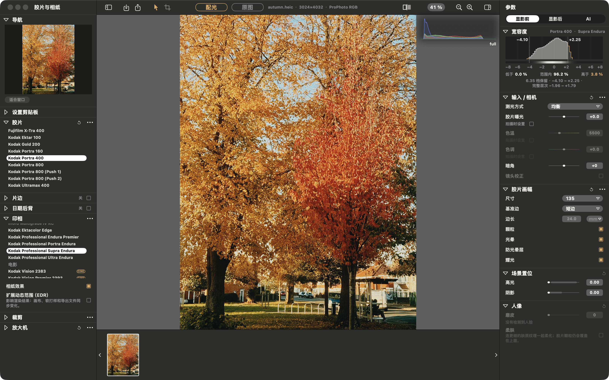

<!-- README_SYNC: source=fc9ef49; updated=2026-11-04 -->
[English](README.md) · **简体中文**

# spektralab-ai

[SpektraLab™](https://github.com/JamesQiu2005/SpektraLab)（macOS 胶片与相纸模拟器）的非官方 fork，加上了 AI：帮你选胶片、推荐构图、精修成片、给人像磨皮——可以用本机的 Ollama，也可以用 Claude。

如果它对你有用，点个 ⭐ [Star](https://github.com/Shaojie66/spektralab-ai)，方便以后回来，也让有同样需求的人更容易找到它。

[](https://github.com/Shaojie66/spektralab-ai)
[](license/LICENSE)

[](https://github.com/JamesQiu2005/SpektraLab)
[](https://github.com/Shaojie66/spektralab-ai/commits/main)



本项目不是 SpektraLab 官方出品，也未获其认可。想要不带 AI 的官方版本，请去 [spektralab.app](https://spektralab.app)。

## 这个 fork 加了什么

| | 做什么 | 在哪运行 |
|---|---|---|
| **AI 选片** | 先按场景定测光，再把每款彩色胶片冲成一张小样表，由视觉模型挑出 3–5 款并说明理由；可以参考一张图 | 你选的模型 |
| **AI 构图** | 测量地平线、视觉重心和人脸，按规则生成 8–12 个裁切，由模型挑三个；地平线歪了会自动拉直 | 你选的模型，测量在本机 |
| **AI 精修** | 最多三轮，只调现有参数——测光、曝光、滤色、颗粒、调色——不碰胶片、裁剪和像素；可以参考一张图 | 你选的模型 |
| **人像磨皮** | 人像一节的滑块，在胶片之前抹匀斑驳，颗粒照样落在皮肤上；合影里的小脸也能找到 | 本机，不需要模型 |

所有 AI 改动都能一步撤回；只有你点按钮时照片才会发出去，用本地 Ollama 时什么都不离开这台 Mac。每个功能怎么工作、会动什么不会动什么、实测数据：[docs/AI.zh-CN.md](docs/AI.zh-CN.md)。

## 基于什么

其余部分就是 SpektraLab 1.3.5，已与上游合并：

- **光谱计算，不是 LUT。** 光线以 81 个波长穿过胶片与相纸各自的染料层，和暗房里的过程一致。
- **物理尺度。** 告诉它底片是 120 还是 135，颗粒、光晕和成色剂扩散就按画幅以微米为单位缩放。
- **快。** C++ Metal 引擎直接编译进应用，全分辨率渲染不到一秒。
- **保留高光层次。** 本 fork 让新照片默认打开相纸的扩展动态范围（EDR），高光不会被相纸曲线的肩部压平。
- **胶片本身。** 片边、日期后背、半格拼接、设置同步，以及命令行和 MCP 服务——详见[SpektraLab 的 README](https://github.com/JamesQiu2005/SpektraLab/blob/main/README.zh-CN.md)。

| RAW 解码 ⟷ 胶片与相纸（⌥\\） | 1:1 颗粒 |
|---|---|
|  |  |

## 快速开始

这个 fork 没有预编译的发布版本，需要从源码编译。要求 Apple 芯片、macOS 15 或更高、
Xcode 26（本仓库用 26.3 编译和测试）。

```bash
git clone https://github.com/Shaojie66/spektralab-ai.git
cd spektralab-ai
engine/build.sh bundle                 # engine, kernels, baked resources
cd modern_UI/Spektrafilm
xcodebuild -project Spektrafilm.xcodeproj -scheme Spektrafilm \
           -configuration Debug -derivedDataPath build/DerivedData build
open build/DerivedData/Build/Products/Debug/SpektraLab.app
```

想用本地模型，先装 [Ollama](https://ollama.com)，再拉一个能读图的模型：

```bash
ollama pull gemma4:26b
```

然后在 **设置 ▸ AI** 里开启，选 OpenAI 兼容，基础地址 `http://localhost:11434/v1`，模型 `gemma4:26b`。用 Claude 的话选 Anthropic 并填入 Key，Key 存在 macOS 钥匙串里。

`engine/resources/` 有改动时重新运行 `engine/build.sh bundle`。如果 Xcode 突然找不到 `metal`，清理一下构建文件夹（⇧⌘K）。

## 测试

```bash
xcodebuild -project Spektrafilm.xcodeproj -scheme SpektrafilmTests \
           -configuration Debug -derivedDataPath build/DerivedData test
```

共 658 个测试。相机测试素材不在本仓库里：没有素材时会跳过 78 个，大约 45 秒跑完，照样报告 0 失败——看耗时，别只看失败数。想用自己的照片把"打开、配光、全尺寸冲印、导出"完整走一遍并分步计时：

```bash
TEST_RUNNER_SPK_PIPELINE_DIR=~/photos TEST_RUNNER_SPK_PIPELINE_OUT=/tmp/out \
xcodebuild -project Spektrafilm.xcodeproj -scheme SpektrafilmTests \
           -configuration Debug -derivedDataPath build/DerivedData \
           test -only-testing:SpektrafilmTests/PipelinePhotoTests
```

想用参考图在真实模型上测量 AI 助手的效果，见 [`modern_UI/Spektrafilm/Tools/ai-eval/README.md`](modern_UI/Spektrafilm/Tools/ai-eval/README.md)。

## 目录

| 路径 | 内容 |
|---|---|
| `modern_UI/Spektrafilm/` | 应用：SwiftUI、AppKit、Metal |
| `modern_UI/Spektrafilm/Spektrafilm/AI/` | 本 fork 的 AI：小样、提示词、裁切、人脸遮罩、磨皮 |
| `engine/` | C++20 渲染引擎、MSL 内核与 C ABI |
| `docs/AI.zh-CN.md` | AI 功能详细说明 |
| `ARCHITECTURE.md` | 整体结构——AI 在 §7.14 |
| `AGENTS.md` | 开发约定，以及真正花过时间的坑 |

## 与上游的关系

AI 功能曾向上游提交过，现在在这里维护。对 SpektraLab 本身的修复会提交给上游：在这里发现的 sidecar 监视器问题，修复已作为 [#54](https://github.com/JamesQiu2005/SpektraLab/pull/54) 合并进上游。
Windows 和 Linux 相关的工作属于上游的 `Windows_Linux` 分支。

AI 功能的问题和想法请提到 [Issues](https://github.com/Shaojie66/spektralab-ai/issues)；也欢迎提交 Pull Request：一个提交只做一件事，提交说明写清做了什么、为什么。

## 致谢与许可

胶片过程模型、28 款实测彩色配置与放大 LUT 来自 Andrea Volpato 的 [spektrafilm](https://github.com/andreavolpato/spektrafilm)；
4 款实测黑白配置来自 Hanze Qiu；SpektraLab 是该引擎的原生 C++/Metal 移植，以及围绕它构建的应用。

| 部分 | 许可 |
|---|---|
| 应用与引擎 | GPL-3.0-or-later |
| 胶片与相纸配置、放大 LUT | CC BY-SA 4.0 |
| metal-cpp | Apache-2.0 |

全部许可文本随应用附带，见 **关于 SpektraLab**。

## 商标

以下为 SpektraLab 的商标声明原文：

> SpektraLab™ 名称及其图标由广州松子智能科技服务有限公司管理，相关商标注册申请正在办理中。
>
> 欢迎 Fork。你可以依照开源许可研究、修改、移植和再分发代码；这些许可涵盖代码与数据，但不包括名称与图标。在个人 fork 中保留它们没有问题。如果要向他人发布构建版本，即使是免费的，也请换用自己的名称和图标。欢迎说明项目基于 SpektraLab，但请清楚标明它并非官方版本。
>
> 对于冒充官方版本或暗示获得我们认可的行为，我们保留依法采取措施的权利。

本仓库是个人 fork，不发布构建版本，也不是官方版本。

---

⭐ [Star](https://github.com/Shaojie66/spektralab-ai) 一下方便回来 ·
遇到问题或有想法，[提 Issue](https://github.com/Shaojie66/spektralab-ai/issues) ·
也欢迎 [Pull Request](https://github.com/Shaojie66/spektralab-ai/pulls)。
